<div align="center">

# Evan Chen · Portfolio

**A personal portfolio that is also a living pixel-art ecosystem.**

Scroll through my projects and experience while a whole reef, a pond or a moonlit shrine forest lives, hunts, plays and sleeps behind the page.

[](https://evanchen.info)


[Three worlds](#three-worlds-one-portfolio) · [Things to try](#things-to-try) · [How it works](#how-it-works) · [Run it locally](#run-it-locally) · [Adding a project](#adding-a-project)

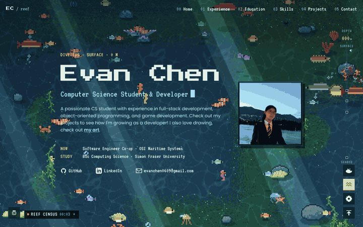

<sub>Switching from the reef to the pond and back. Every fish, frog and duck is simulated, not looped.</sub>

</div>

---

## Three worlds, one portfolio

The content is the same everywhere: hero, experience, education, skills, projects and contact. Only the world behind it changes, from the buttons at the bottom right. The original aquarium is archived, one click away in the settings panel.

<table>
  <tr>
    <td width="33%" align="center">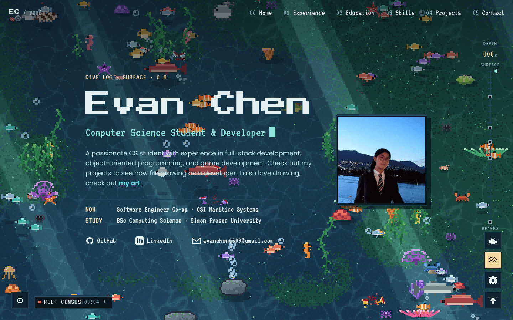<br><b>The reef</b> (default)<br><sub>A dive log over a coral reef</sub></td>
    <td width="33%" align="center">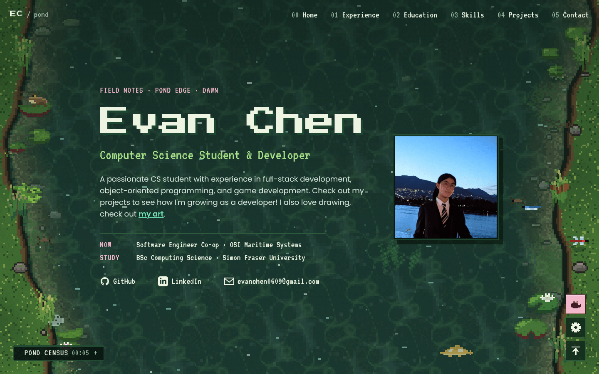<br><b>The pond</b><br><sub>Field notes over a lily pond</sub></td>
    <td width="33%" align="center">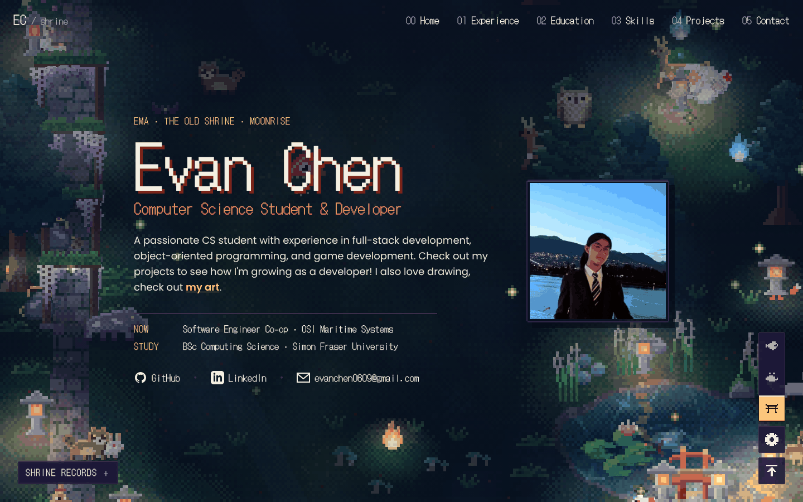<br><b>The shrine forest</b><br><sub>Ema plaques in a lantern-lit forest</sub></td>
  </tr>
</table>

### 🪸 The reef

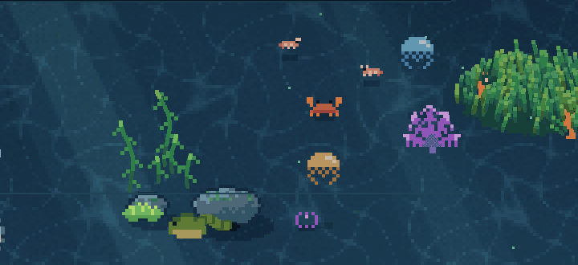

A pixel-art reef seen from slightly above, as tall as the page and scrolled with it. A depth gauge turns scrolling into a dive.

- **A living seabed.** Every cell is simulated: nutrients seep, algae grows and sheds plankton, and blood stains the sand for a while.
- **22 species that feed, flee, hunt, breed and die.** Pufferfish inflate when cornered, octopuses camouflage and escape in clouds of ink, morays strike from their dens, anglerfish lure minnows in the deep, mantis shrimp punch crabs, and hermit crabs queue by size to swap shells.
- **Things happen.** Dolphin pods herd minnows into bait balls, whale carcasses sink and feed the reef down to the bones, big fish queue at cleaner stations, and the corals spawn on special nights.
- **Shadows pass overhead.** A manta or a whale far above, sliding across the sand.

### 🐸 The pond

<table>
  <tr>
    <td width="50%">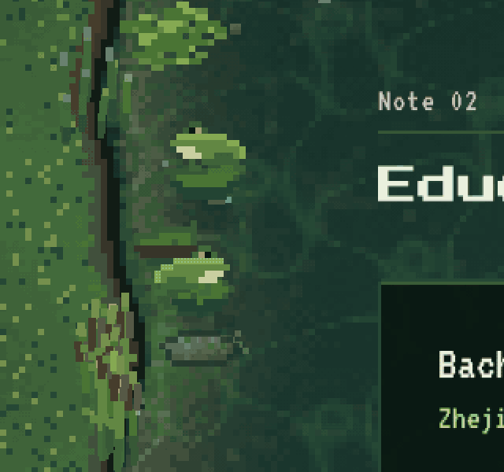</td>
    <td width="50%">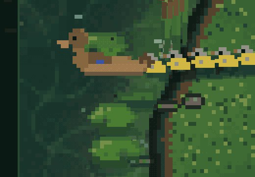</td>
  </tr>
  <tr>
    <td align="center"><sub>Frogs croak, leap between pads and splash into the water</sub></td>
    <td align="center"><sub>A hen leads her ducklings out from her nest on the bank</sub></td>
  </tr>
  <tr>
    <td width="50%">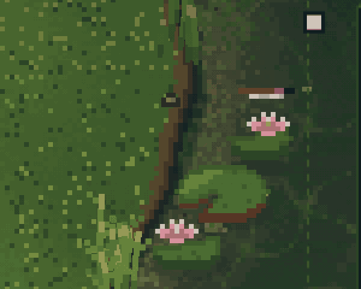</td>
    <td width="50%">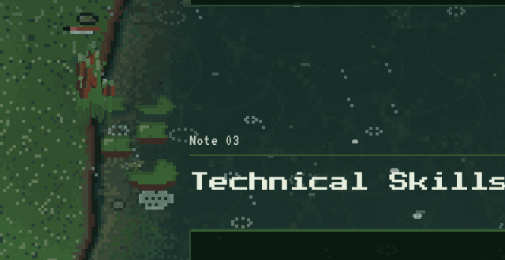</td>
  </tr>
  <tr>
    <td align="center"><sub>The evening chorus: dusk, night, fireflies and lilies closing</sub></td>
    <td align="center"><sub>Rain rings the whole surface and sets the frogs calling</sub></td>
  </tr>
</table>

The pond has real depth. A translucent water surface separates the bed, everything underwater, the surface itself and the air above it, and every creature knows which layer it is in.

- **A frog's whole life.** Frogspawn darkens and wobbles, then hatches into schools of tadpoles that graze algae, grow back legs, then front legs, and climb out as froglets. Adults sit, croak, catch midges with their tongues, leap between pads, float with only their eyes above water, and pair up to lay new spawn.
- **Ducks.** Mallard pairs leave V-shaped wakes, dabble tail-up, preen, run across the water to take off and splash-land. A tufted duck dives clean under.
- **Fish.** Schooling minnows, slow koi that rise for insects, a catfish stirring up silt, and a pike lurking in the weeds.
- **And more.** Dragonflies, water striders with dimple shadows, snails on the reed stems, a turtle basking on a log, and a heron that comes down to fish in the shallows (or just passes over as a shadow that scatters the frogs).
- **Plants that react.** Lily pads drift aside for swimmers, duckweed parts around them, and reeds bend.
- **Events.** Rain, a mayfly hatch with fish rising, and the evening chorus.

### ⛩️ The shrine forest

<table>
  <tr>
    <td width="50%">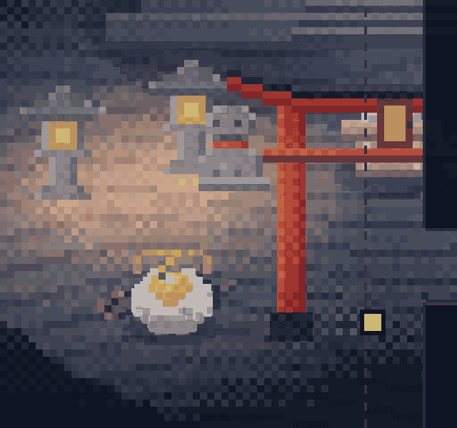</td>
    <td width="50%">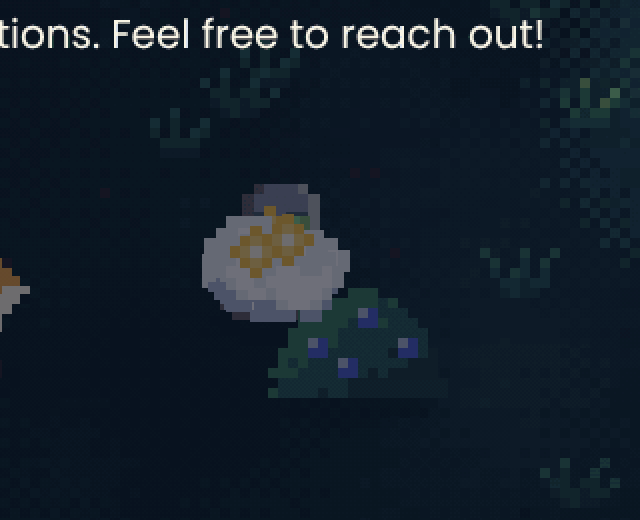</td>
  </tr>
  <tr>
    <td align="center"><sub>A crow pecks a disguised tanuki out of its teapot</sub></td>
    <td align="center"><sub>A fox sniffs out a fake statue and kicks it over</sub></td>
  </tr>
  <tr>
    <td width="50%">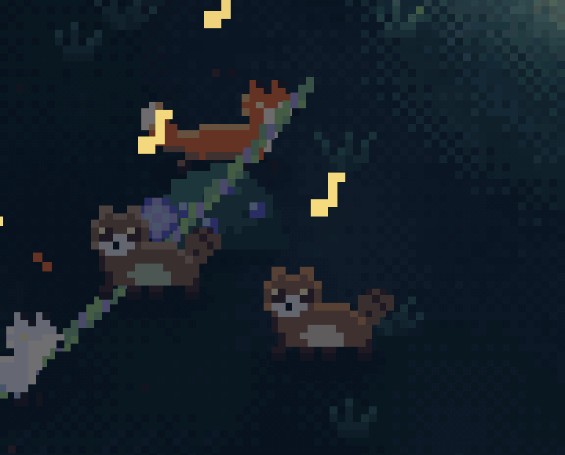</td>
    <td width="50%">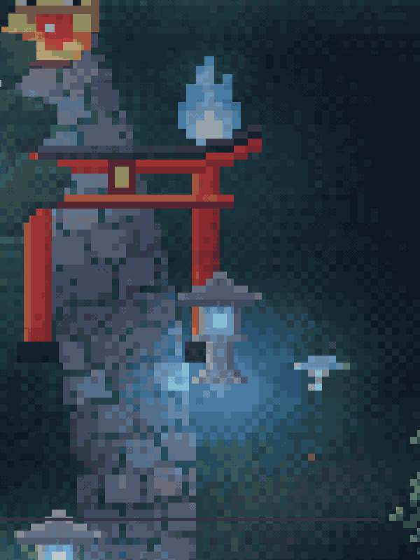</td>
  </tr>
  <tr>
    <td align="center"><sub>Tanuki against foxes in a tug of war on a wisteria vine</sub></td>
    <td align="center"><sub>The night parade turns every lantern ghost blue</sub></td>
  </tr>
</table>

A moss-and-cedar forest under a permanent night, where the stone lanterns are what the page is lit by. A flagstone approach winds down the page past a main hall, an Inari shrine with its tunnel of gates, a koi pond and bridge, a bamboo grove, a pagoda, a raked zen garden and more. There are no humans here: the shrine is kept by living brooms.

- **Tanuki and kitsune after the offerings.** They want what's on the altars, which the broom spirits restock and guard. Rivals who meet face off and scrap in a cloud of dust. Either may put a leaf on its head and turn into a teapot, a lantern or a statue, then creep towards an offering in little hops. Hold your cursor near one and it freezes; click it and it gives itself away.
- **Folklore everywhere.** A baku drinks dreams from sleepers, a tsuchinoko bowls down the path and vanishes when noticed, nekomata dance on the rooftops when no one's watching, akaname lick dirty basins clean, kasa-obake leap out of the bamboo at passers-by, and a kappa wades ashore for walks round its pond, spilling its dish when it bows.
- **A forest that feeds itself.** Berry bushes and persimmon windfalls feed the mice, hares and rivals, then grow back. Deer and tanuki soak in a hot spring, gravel takes footprints, and mist lies low until a lantern finds it.
- **They play together, feuds forgotten.** Tag, dancing in rings, tossing a soul-flame back and forth, follow-the-leader down the path that ends in a heap, tug of war on a wisteria vine, a persimmon kickabout and a fruit fight under a shaken tree. A tanuki's belly drumming draws a crowd to dance round it, until one note too hard knocks it out.
- **Mischief and its consequences.** Crows land on disguised tanuki and peck them out; foxes circle a suspicious statue, sniff it and kick it over.
- **Events.** Moon viewing, a disguise contest, the lantern festival and the night parade, which turns every lantern ghost blue.

### 🐠 The aquarium (archived)

The original page, now opened from the settings panel: smooth, full-colour fish that school, dart, form conga lines, get curious about food and pair up to breed. Drop fish food (or love food), grab and carry fish, open the fish tank, and follow the built-in tutorial.

## Things to try

<table>
  <tr>
    <td width="62%" valign="top">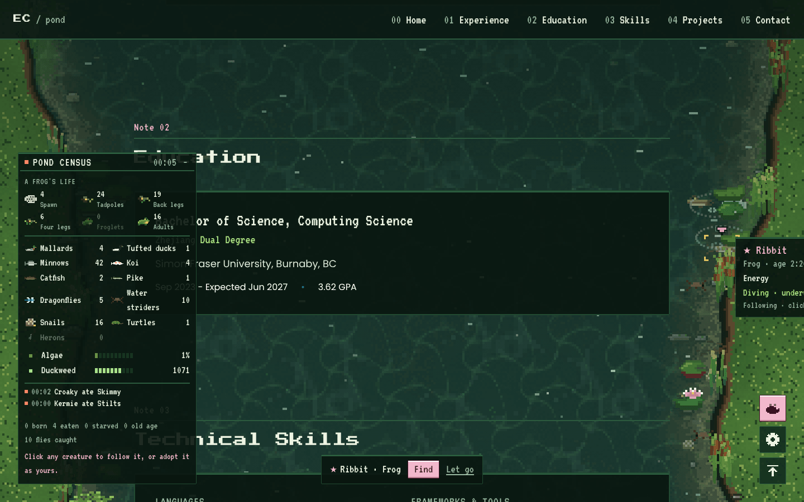</td>
    <td width="38%" valign="top" rowspan="2">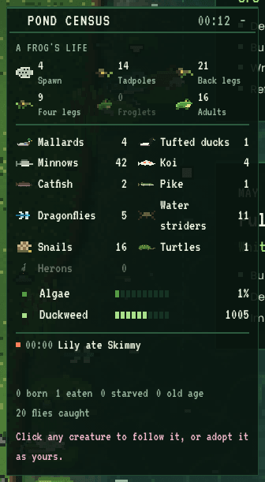</td>
  </tr>
  <tr>
    <td valign="top">

- **Hover** over any creature to see what it is and what it is doing.
- **Click** it to follow it around.
- **Adopt** it and give it a name. It comes back on your next visit, and when it dies the adoption passes down its family line.
- **Open the census** (bottom left) for live counts, including every stage of a frog's life, and a feed of what just happened.
- **Move your mouse fast** near the frogs and watch them dive.
- **Hold your cursor** near a disguised tanuki in the shrine forest to freeze it, and click to catch it out.
- **Type the Konami code** (↑ ↑ ↓ ↓ ← → ← → B A) on the reef, the pond or the shrine for a hidden debug panel. It spawns any creature and starts any event.

    </td>
  </tr>
</table>

<details>
<summary><b>The hidden debug panel</b></summary>
<br>
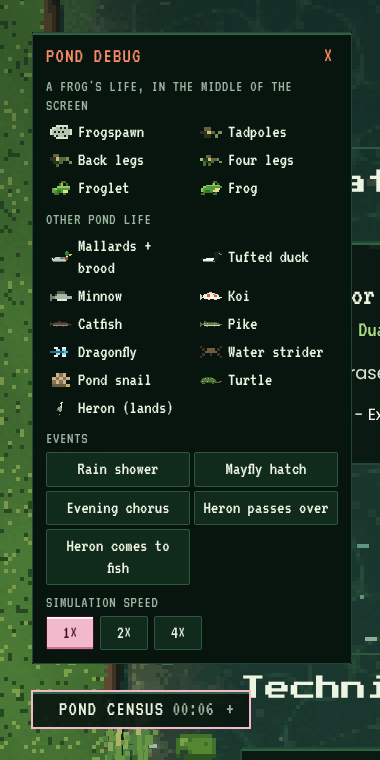
</details>

### On a phone

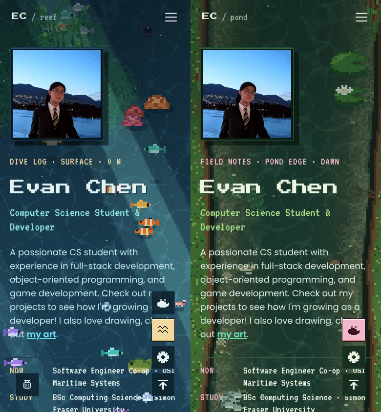

Every world scales down to phone widths, with the plants and landmarks kept to the margins so the content stays readable.

## How it works

The pixel worlds are small simulations that run alongside the page, not videos or looping sprites.

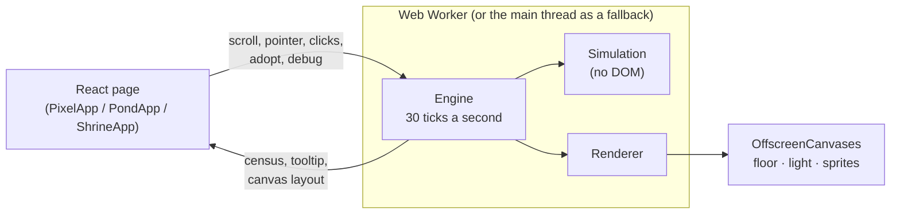

- **Off the main thread.** Each world hands its canvases to a Web Worker as `OffscreenCanvas`es, so the simulation and drawing never hold up scrolling. Browsers that can't do this run the same engine on the main thread.
- **A DOM-free simulation.** `lib/pixelOcean.ts` (the reef), `lib/pond.ts` (the pond) and `lib/shrine.ts` (the shrine forest) step 30 times a second. Every species has its own `think*` method; populations are kept in balance by caps, breeding and newcomers arriving when numbers run low.
- **A 2.5D camera.** The world is seen from above at an angle. Height lifts a sprite up the screen and draws it a little bigger, with a shadow on the ground (or the water) below it. Sprites are depth-sorted with squash and stretch.
- **Cheap where it counts.** The sea bed, the pond bed and the forest floor are painted once at one canvas pixel per cell and scrolled natively by the browser. Only a window around the view is redrawn, and plants are drawn as batched runs of rectangles. On slow devices the finishing touches drop out before the frame rate does.
- **Pixel art made in code.** Sprites are character maps, sketched and previewed with a pixel-art tool, then drawn with no smoothing so every art pixel stays square.

Measured in headless Chromium at a 1440 × 900 view, on a page 6000 px tall:

| | One simulation step | One frame of drawing |
|---|---|---|
| Reef | ~1.2 ms | ~2.6–3.0 ms |
| Pond | ~0.7 ms | ~2.3–2.7 ms |

The pages also respect the performance panel (quality tier and a 30/60 fps cap), and stop animating while the tab is hidden.

## Run it locally

You'll need [Node.js](https://nodejs.org/) 20 or newer.

```sh
git clone https://github.com/EvanDongChen/PortfolioSite.git
cd PortfolioSite
npm install
npm run dev        # http://localhost:3000
```

| Command | What it does |
|---|---|
| `npm run dev` | Starts the dev server on port 3000. |
| `npm run build` | Builds the site into `dist/`. |
| `npx tsc --noEmit` | Type-checks (Vite doesn't). |
| `npm run deploy` | Builds and publishes to GitHub Pages. |

Pushes to the `update` branch also deploy automatically through GitHub Actions.

> [!TIP]
> In development, add `?pond-main` or `?shrine-main` to the URL to run the pond or the shrine forest on the main thread, where you can reach it from the console as `window.__pond` or `window.__shrine`.

## Project structure

```
├── index.tsx              picks the page: reef, pond, shrine forest or aquarium
├── PixelApp.tsx           the reef page
├── PondApp.tsx            the pond page
├── ShrineApp.tsx          the shrine-forest page
├── App.tsx                the aquarium page
├── components/            page content, buttons, panels, and the canvas hosts
├── contexts/              theme and performance settings
├── data/portfolio.ts      projects, experience, education and skills
├── lib/
│   ├── pixelOcean*.ts     the reef: simulation, renderer, sprites
│   ├── reefEngine.ts      runs the reef (in reefWorker.ts where possible)
│   ├── pond*.ts           the pond: simulation, renderer, sprites, engine, worker
│   ├── shrine*.ts         the shrine forest: simulation, renderer, sprites, engine, worker
│   ├── pageTransition.ts  the wave of pixel blocks between pages
│   └── adoption.ts        your adopted creature, kept in localStorage
├── pixel-theme.css        the pixel UI (fonts, 9-slice frames, cursors)
├── pond-theme.css         the pond's colours and lettering over it
├── shrine-theme.css       the shrine's colours and lettering over it
└── public/images/         project thumbnails (960 px .webp)
```

## Adding a project

1. Put the thumbnail in `image-originals/` and a 960 px-wide `.webp` copy in `public/images/`. `scripts/optimize-images.mjs` converts PNG and JPG files in `public/images` to `.webp`.
2. Add an entry to the `projects` list in `data/portfolio.ts` with a `title`, `description`, `image`, `tags`, `codeUrl` and an optional `linkLabel` (defaults to "View Code").

## Credits

- Pixel fonts: [Press Start 2P](https://fonts.google.com/specimen/Press+Start+2P) and [VT323](https://fonts.google.com/specimen/VT323) (SIL Open Font License); [Pixelify Sans](https://fonts.google.com/specimen/Pixelify+Sans) and [Jersey 15](https://fonts.google.com/specimen/Jersey+15) on the pond and [DotGothic16](https://fonts.google.com/specimen/DotGothic16) in the shrine forest (all SIL Open Font License); body text in [Poppins](https://fonts.google.com/specimen/Poppins).
- All creatures, plants and scenery are original pixel art.

<div align="center">
<br>
Made by <a href="https://evanchen.info">Evan Chen</a> · <a href="https://github.com/EvanDongChen">GitHub</a>
</div>
